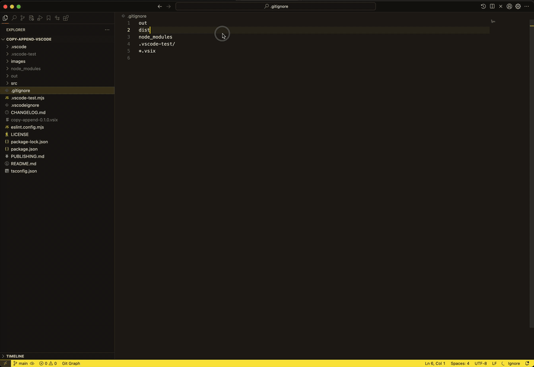

# Copy Append

Collect text from several places (different files, different parts of a file) into the clipboard, then paste it all at once with a normal **Ctrl+V** / **Cmd+V**.



> The demo uses custom shortcuts (⇧⌘C / ⇧⌘V). The defaults are **⌃⌘C** / **⌃⌘V** on macOS and **Ctrl+Alt+C** / **Ctrl+Shift+Alt+V** on Windows and Linux. See [Keyboard shortcuts](#keyboard-shortcuts) to change them.

## Features

- **Copy Append** adds the current selection to what's already on the clipboard, with a separator between parts (a newline by default).
  - Nothing selected? It appends the current line, the same way VS Code's Copy does.
  - Multiple cursors or selections? Each one is appended, top to bottom.
- **Normal paste** pastes everything you collected. There's no special paste command.
- **Copy Append: Paste and Clear** pastes everything and then clears, so your next append starts a new collection.
- **Normal copy** replaces the clipboard as usual, which starts a fresh collection.
- **Status bar counter** (a clipboard icon and a number, such as `3`) shows how many parts are collected. Click it to preview the parts, open the full text in an editor, or clear it. It's hidden when nothing is collected.
- **Copy Append: Clear** empties the clipboard and resets the counter.
- **Optional file headers** add a comment line before each part, such as `// src/app.ts:10-14` (in the right comment style for the language).

### How the counter stays correct

The extension remembers exactly what it last wrote to the clipboard. If the clipboard holds something else when you run **Copy Append** (because you copied normally, in VS Code or in another app), that content becomes part 1 of a new collection and your selection becomes part 2. The status bar counter also disappears a few seconds after the clipboard changes.

Each VS Code window keeps its own counter. If you append from two windows, the text is still combined correctly, but the count starts over in whichever window you switched to.

## Installation

- **VS Code Marketplace:** search for **Copy Append** in the Extensions view (`Ctrl+Shift+X` / `Cmd+Shift+X`), or run
  `code --install-extension pineapple-head-lab.copy-append`
- **Open VSX** (VSCodium, Cursor, Gitpod, …): search for **Copy Append**, or download it from open-vsx.org.
- **From a `.vsix` file:** run `code --install-extension copy-append-0.1.0.vsix`, or in the Extensions view open the `…` menu and choose **Install from VSIX…**.

## Usage

1. Select some text and press **Ctrl+Alt+C** (**Ctrl+Cmd+C** on macOS).
2. Go to another file or another part of the same file, select more text, and press it again. The status bar shows a clipboard icon with `2`.
3. Paste anywhere with **Ctrl+V** / **Cmd+V**.
4. To start over, copy something normally, or run **Copy Append: Clear**. Or use **Paste and Clear** (**Ctrl+Shift+Alt+V** / **Ctrl+Cmd+V**) to paste and start over in one step.

All commands are also available in the Command Palette (`Ctrl+Shift+P` / `Cmd+Shift+P`): **Copy Append**, **Copy Append: Clear**, **Copy Append: Paste and Clear**, and **Copy Append: Show Collected Text**.

## Keyboard shortcuts

| Command | Windows / Linux | macOS |
| --- | --- | --- |
| Copy Append | `Ctrl+Alt+C` | `Ctrl+Cmd+C` (⌃⌘C) |
| Copy Append: Clear | `Ctrl+Shift+Alt+C` | `Ctrl+Shift+Cmd+C` (⌃⇧⌘C) |
| Copy Append: Paste and Clear | `Ctrl+Shift+Alt+V` | `Ctrl+Cmd+V` (⌃⌘V) |

The shortcuts only work while a text editor has focus. They were checked against VS Code's default keybindings on all three platforms:

- On macOS, `Cmd+Alt+C` and `Cmd+Shift+Alt+C` are already used (Copy Path, case-sensitive toggles in Find and Search, …), so ⌃⌘C and ⌃⇧⌘C are used instead. VS Code doesn't bind them, or ⌃⌘V, by default.
- On Windows and Linux, VS Code uses `Ctrl+Alt+C` and `Ctrl+Shift+Alt+C` only outside the text editor (Explorer, Search results, Debug Watch, the built-in browser), so there's no conflict. `Ctrl+Alt+V` is avoided because VS Code uses it for voice dictation when a speech extension is installed.

**AltGr keyboard layouts (Windows):** on Windows, `Ctrl+Alt` acts as `AltGr`. If your layout types a character with `AltGr+C` (for example `ć` in Polish), rebind Copy Append to another key.

**Change a shortcut:** open **Preferences: Open Keyboard Shortcuts** (`Ctrl+K Ctrl+S` / `Cmd+K Cmd+S`), search for `Copy Append`, and double-click the binding. You can also edit `keybindings.json`:

```jsonc
[
  { "key": "ctrl+shift+c", "command": "copyAppend.append", "when": "editorTextFocus" },
  { "key": "ctrl+alt+c", "command": "-copyAppend.append" } // remove the default
]
```

For example, to use ⇧⌘C / ⇧⌘V on macOS (this replaces *Open New External Terminal* and, in Markdown files, *Toggle Preview* while you're in the editor):

```jsonc
[
  { "key": "shift+cmd+c", "command": "copyAppend.append", "when": "editorTextFocus" },
  { "key": "shift+cmd+v", "command": "copyAppend.pasteAndClear", "when": "editorTextFocus && !editorReadonly" }
]
```

## Settings

| Setting | Default | Description |
| --- | --- | --- |
| `copyAppend.separator` | `"\n"` | Text inserted between parts. In the Settings UI you can type `\n` for a newline and `\t` for a tab, such as `\n\n` for a blank line or `\n---\n`. |
| `copyAppend.addFileHeader` | `false` | Adds a comment line with the file name and line range before each part, such as `// src/app.ts:10-14`, `# script.py:3`, or `<!-- index.html:7-9 -->`. |
| `copyAppend.showStatusBar` | `true` | Shows the parts counter in the status bar. |

Example `settings.json`:

```json
{
  "copyAppend.separator": "\n\n",
  "copyAppend.addFileHeader": true
}
```

## Development

```bash
npm install
npm run compile      # or: npm run watch
npm run test:unit    # fast unit tests in Node
npm test             # integration tests in a downloaded VS Code (uses the real clipboard)
```

Press **F5** in VS Code to launch an Extension Development Host with the extension loaded.

To package and publish, see [PUBLISHING.md](PUBLISHING.md).

## License

Copyright (C) 2026 unomns

This program is free software: you can redistribute it and/or modify it under the terms of the **GNU General Public License v3.0** as published by the Free Software Foundation.

This program is distributed in the hope that it will be useful, but WITHOUT ANY WARRANTY; without even the implied warranty of MERCHANTABILITY or FITNESS FOR A PARTICULAR PURPOSE. See [LICENSE](LICENSE) for the full text.
